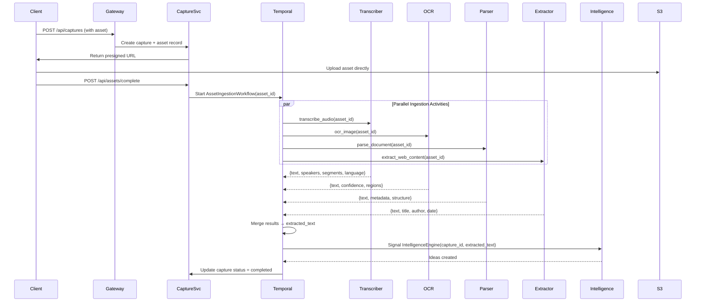
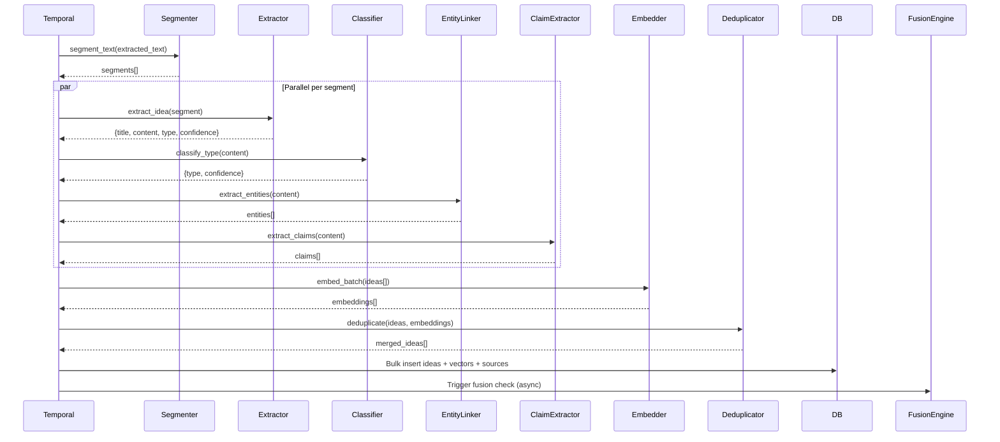
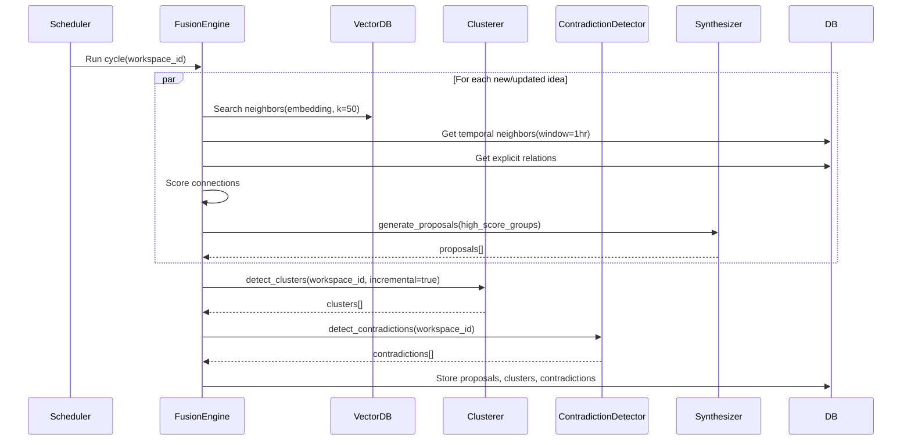
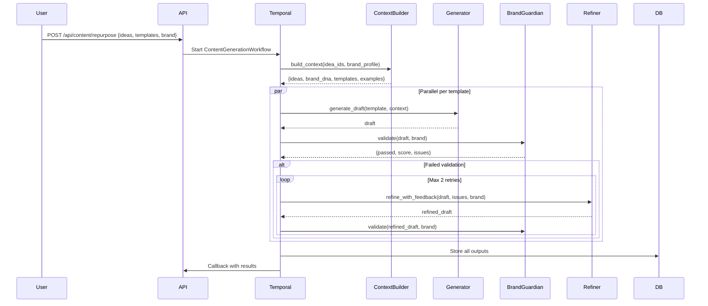
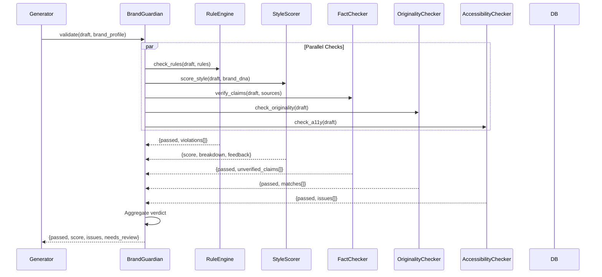
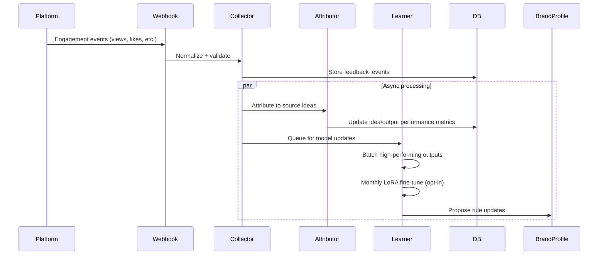

# IdeaOS Agent Workflows

**Version:** 1.0  
**Status:** Draft  
**Last Updated:** 2026-10-31

---

## 1. Overview

IdeaOS employs a **multi-agent architecture** where specialized agents collaborate through durable workflows (Temporal) to transform raw captures into published content. Each agent is a stateless worker that executes a specific stage of the pipeline, communicating via typed messages and shared database state.

```
┌─────────────────────────────────────────────────────────────────────────────────┐
                        AGENT ORCHESTRATION LAYER (Temporal)
└─────────────────────────────────────────────────────────────────────────────────┘
                                      │
        ┌─────────────────────────────┼─────────────────────────────┐
        ▼                             ▼                             ▼
┌───────────────┐            ┌───────────────┐            ┌───────────────┐
│  INGESTION    │            │ INTELLIGENCE  │            │    FUSION     │
│  AGENTS       │            │  AGENTS       │            │   AGENTS      │
├───────────────┤            ├───────────────┤            ├───────────────┤
│ • Transcriber │            │ • Extractor   │            │ • Connector   │
│ • OCR Agent   │            │ • Classifier  │            │ • Clusterer   │
│ • Parser Agent│            │ • Entity Link │            │ • Contradict  │
│ • Extractor   │            │ • Embedder    │            │ • Synthesizer │
└───────┬───────┘            └───────┬───────┘            └───────┬───────┘
        │                             │                             │
        └─────────────────────────────┼─────────────────────────────┘
                                      ▼
                         ┌───────────────────────┐
                         │   CONTENT AGENTS      │
                         ├───────────────────────┤
                         │ • Generator           │
                         │ • Brand Guardian      │
                         │ • Refiner             │
                         └───────────┬───────────┘
                                     │
                                     ▼
                         ┌───────────────────────┐
                         │   FEEDBACK AGENTS     │
                         ├───────────────────────┤
                         │ • Collector           │
                         │ • Attributor          │
                         │ • Learner             │
                         └───────────────────────┘
```

---

## 2. Idea Ingestion Pipeline

### 2.1 Workflow: `AssetIngestionWorkflow`



### 2.2 Agent Specifications

#### **Transcriber Agent** (`transcriber-agent`)
| Property | Detail |
|----------|--------|
| **Input** | Asset ID (audio/video), language hint |
| **Output** | `{text, segments[], speakers[], language, confidence}` |
| **Model** | WhisperX (large-v3) with diarization |
| **Config** | `beam_size=5`, `vad_filter=true`, `word_timestamps=true` |
| **Custom Vocab** | Per-workspace term boosting (product names, people) |
| **Retry** | 3x with exponential backoff |
| **Timeout** | 10 min for 60 min audio |
| **GPU** | Required (A10G or equivalent) |

#### **OCR Agent** (`ocr-agent`)
| Property | Detail |
|----------|--------|
| **Input** | Asset ID (image/PDF/video frame) |
| **Output** | `{text, confidence, regions[{bbox, text, conf}], language}` |
| **Model** | PaddleOCR (PP-OCRv4) + layout analysis |
| **Config** | `det_model_dir`, `rec_model_dir`, `use_angle_cls=true` |
| **Video** | Samples 1 fps, deduplicates similar frames |
| **PDF** | Renders pages at 200 DPI, OCR each |
| **Retry** | 2x |
| **Timeout** | 2 min per asset |

#### **Document Parser Agent** (`parser-agent`)
| Property | Detail |
|----------|--------|
| **Input** | Asset ID (PDF, DOCX, EPUB, PPTX) |
| **Output** | `{text, metadata, structure[{heading, level, content}], tables[], images[]}` |
| **Libraries** | pdfplumber, python-docx, ebooklib, python-pptx |
| **Features** | Preserves hierarchy, extracts tables as markdown, OCRs embedded images |
| **Retry** | 2x |
| **Timeout** | 5 min |

#### **Web Extractor Agent** (`web-extractor-agent`)
| Property | Detail |
|----------|--------|
| **Input** | Asset ID (URL capture) |
| **Output** | `{text, title, author, date, metadata, screenshot_key, dom_snapshot_key}` |
| **Method** | Readability + Playwright for JS-heavy sites |
| **Paywall** | Detects and flags; attempts textise dot iitty |
| **Retry** | 2x with different user agents |
| **Timeout** | 60 sec |

---

## 3. Idea Intelligence Engine

### 3.1 Workflow: `IdeaExtractionWorkflow`



### 3.2 Agent Specifications

#### **Segmenter Agent** (`segmenter-agent`)
| Property | Detail |
|----------|--------|
| **Input** | Raw text (up to 100K chars) |
| **Output** | Semantic segments (paragraphs, topics, speakers) |
| **Method** | TextTiling + speaker change detection + heading detection |
| **Max Segment** | 2000 chars (optimal for embedding) |
| **Overlap** | 200 chars between segments |

#### **Idea Extractor Agent** (`idea-extractor-agent`)
| Property | Detail |
|----------|--------|
| **Input** | Text segment + context (previous/next segments) |
| **Output** | `{title, content, type, confidence, summary}` |
| **Model** | Claude 3.5 Sonnet (structured output) |
| **Prompt** | Few-shot with type definitions + examples |
| **Types** | insight, task, question, reference, signal, decision, hypothesis |
| **Validation** | Confidence < 0.6 → flag for review |

#### **Classifier Agent** (`classifier-agent`)
| Property | Detail |
|----------|--------|
| **Input** | Idea content |
| **Output** | `{type, confidence, alternatives[]}` |
| **Model** | Fine-tuned DistilBERT (fast) + LLM fallback |
| **Accuracy** | >90% on 7-class taxonomy |
| **Calibration** | Temperature scaling on validation set |

#### **Entity Linker Agent** (`entity-linker-agent`)
| Property | Detail |
|----------|--------|
| **Input** | Idea content |
| **Output** | `entities[{type, value, confidence, span, wiki_id?}]` |
| **Models** | spaCy NER + GLiNER (zero-shot) + custom workspace entities |
| **Types** | PERSON, ORG, PRODUCT, CONCEPT, METRIC, DATE, MONEY, TECH |
| **Linking** | Wikidata for known entities; workspace registry for custom |

#### **Claim Extractor Agent** (`claim-extractor-agent`)
| Property | Detail |
|----------|--------|
| **Input** | Idea content (for research-type ideas) |
| **Output** | `claims[{claim, evidence, confidence, source_span, type}]` |
| **Model** | DeBERTa-v3-large (NLI) + LLM for complex claims |
| **Claim Types** | factual, causal, predictive, normative, definitional |
| **Evidence Linking** | Maps to source spans in original capture |

#### **Embedder Agent** (`embedder-agent`)
| Property | Detail |
|----------|--------|
| **Input** | Idea content (title + summary + content) |
| **Output** | 1536-dim vector (text-embedding-3-large) |
| **Batching** | 100 texts per API call |
| **Caching** | Redis cache keyed by content hash |
| **Fallback** | BGE-M3 local if API unavailable |

#### **Deduplicator Agent** (`deduplicator-agent`)
| Property | Detail |
|----------|--------|
| **Input** | New ideas + existing idea embeddings |
| **Output** | Merged ideas with combined sources |
| **Algorithm** | HNSW search (k=10, threshold=0.92) → LLM merge decision |
| **Merge Strategy** | Combine content, union sources, max confidence, newest timestamp |

---

## 4. Idea Fusion Engine

### 4.1 Workflow: `FusionEngineWorkflow` (Scheduled: every 5 min)



### 4.2 Agent Specifications

#### **Connector Agent** (`connector-agent`)
| Property | Detail |
|----------|--------|
| **Input** | Idea + candidate neighbors (semantic, temporal, explicit) |
| **Output** | Scored connections with evidence |
| **Connection Types** | |
| &nbsp;&nbsp;• Semantic | Cosine similarity > 0.75 |
| &nbsp;&nbsp;• Temporal | Captured within 1 hour, same session |
| &nbsp;&nbsp;• Explicit | User-created links |
| &nbsp;&nbsp;• Causal | Claim→Evidence (NLI entailment) |
| &nbsp;&nbsp;• Contradiction | NLI contradiction > 0.8 |
| &nbsp;&nbsp;• Duplicate | Embedding > 0.92 |
| &nbsp;&nbsp;• Elaboration | One idea expands on another |
| **Scoring** | Weighted combo: semantic(0.4) + temporal(0.2) + explicit(0.3) + causal(0.1) |

#### **Clusterer Agent** (`clusterer-agent`)
| Property | Detail |
|----------|--------|
| **Input** | All idea embeddings in workspace |
| **Output** | Clusters with labels, stability scores, member ideas |
| **Algorithm** | HDBSCAN (min_cluster_size=3, min_samples=2) |
| **Incremental** | Daily: only re-cluster new ideas + neighbors |
| **Full Re-cluster** | Weekly |
| **Naming** | LLM generates cluster name + description from member ideas |
| **Stability** | Tracks cluster persistence across runs |

#### **Contradiction Detector Agent** (`contradiction-detector-agent`)
| Property | Detail |
|----------|--------|
| **Input** | Pairs of ideas with conflicting claims |
| **Output** | Contradictions with evidence spans |
| **Model** | DeBERTa-v3-large MNLI (entailment/contradiction/neutral) |
| **Threshold** | Contradiction prob > 0.85 |
| **Filtering** | Only checks ideas with explicit claims |
| **Output** | `{idea_a, idea_b, claim_a, claim_b, confidence, type}` |

#### **Synthesizer Agent** (`synthesizer-agent`)
| Property | Detail |
|----------|--------|
| **Input** | Group of connected ideas (3-10) |
| **Output** | Fusion proposal: `{title, thesis, idea_ids, connection_types, suggested_output, confidence}` |
| **Model** | Claude 3.5 Opus (reasoning-heavy) |
| **Prompt** | "Synthesize these ideas into a higher-level insight. Identify the core thesis, supporting evidence, and what new understanding emerges." |
| **Validation** | Self-consistency check: generate 3x, take majority |
| **Confidence** | Based on connection strengths + synthesis coherence |

---

## 5. Content Generation Agent

### 5.1 Workflow: `ContentGenerationWorkflow`



### 5.2 Agent Specifications

#### **Context Builder Agent** (`context-builder-agent`)
| Property | Detail |
|----------|--------|
| **Input** | Idea IDs + Brand Profile ID |
| **Output** | Structured context for generation |
| **Components** | |
| &nbsp;&nbsp;• Primary Ideas | Full content + sources |
| &nbsp;&nbsp;• Connected Ideas | Top 10 by connection strength |
| &nbsp;&nbsp;• Brand DNA | Style vector, rules, samples, vocabulary |
| &nbsp;&nbsp;• Template Spec | Structure, hooks, length, format |
| &nbsp;&nbsp;• Examples | High-performing past outputs (same template) |
| **Token Budget** | 80% of model context window |

#### **Generator Agent** (`generator-agent`)
| Property | Detail |
|----------|--------|
| **Input** | Template + Context |
| **Output** | Draft content + metadata |
| **Model** | Claude 3.5 Sonnet (balanced) |
| **Templates** | 12+ built-in (see PRD Section 7.1) |
| **Hook Generation** | Generates 3 hook variants per template using 26 formulas |
| **Citation Style** | Platform-appropriate (inline, footnote, parenthetical) |
| **Streaming** | Supports streaming for long outputs |

#### **Refiner Agent** (`refiner-agent`)
| Property | Detail |
|----------|--------|
| **Input** | Draft + Guardian feedback + Brand Profile |
| **Output** | Refined draft |
| **Model** | Claude 3.5 Sonnet |
| **Strategies** | |
| &nbsp;&nbsp;• Fix violations | Direct editing for rule violations |
| &nbsp;&nbsp;• Adjust tone | Rewrites for tone markers |
| &nbsp;&nbsp;• Trim/expand | Length adjustment preserving key points |
| &nbsp;&nbsp;• Add examples | Inserts relevant examples from context |
| **Max Iterations** | 2 auto-retries before human review |

---

## 6. Brand Guardian (Quality Agent)

### 6.1 Workflow: `BrandGuardianWorkflow`



### 6.2 Agent Specifications

#### **Rule Engine** (`rule-engine-agent`)
| Property | Detail |
|----------|--------|
| **Input** | Draft text + Brand Rules |
| **Output** | `{passed, violations[{rule_id, type, severity, message, location}]}` |
| **Rule Types** | |
| &nbsp;&nbsp;• Forbidden Words | Exact + fuzzy match (configurable) |
| &nbsp;&nbsp;• Required Phrases | Must appear (e.g., legal disclaimers) |
| &nbsp;&nbsp;• Length Limits | Per-platform character/word counts |
| &nbsp;&nbsp;• Format | Markdown, emoji, hashtag, bullet rules |
| &nbsp;&nbsp;• Structure | Required sections, heading hierarchy |
| **Deterministic** | 100% recall for exact matches |
| **Performance** | <10ms per draft |

#### **Style Scorer Agent** (`style-scorer-agent`)
| Property | Detail |
|----------|--------|
| **Input** | Draft + Brand Style Vector + Samples |
| **Output** | `{score: 0-10, breakdown: {vocabulary, syntax, tone, formatting}, feedback}` |
| **Model** | Fine-tuned LLM judge (Claude 3.5 Haiku) |
| **Training** | Pairwise comparisons: "Which sounds more like [brand]?" |
| **Calibration** | Aligns with human ratings (Spearman > 0.9) |
| **Features** | Explains top 3 distinguishing features |

#### **Fact Checker Agent** (`fact-checker-agent`)
| Property | Detail |
|----------|--------|
| **Input** | Draft claims + Source ideas (with citations) |
| **Output** | `{passed, unverified[{claim, source_span, suggestion}]}` |
| **Method** | |
| &nbsp;&nbsp;• Source Verification | Claim must be supported by cited source span |
| &nbsp;&nbsp;• External Check | Optional: Serper/Google search for factual claims |
| **Threshold** | Confidence > 0.8 required for "verified" |
| **Scope** | Only checks claims with explicit citations |

#### **Originality Checker Agent** (`originality-checker-agent`)
| Property | Detail |
|----------|--------|
| **Input** | Draft content |
| **Output** | `{passed, matches[{source, similarity, matched_text}]}` |
| **Internal** | Compare against user's past outputs (embedding similarity > 0.85) |
| **External** | Optional: Search API for web similarity (sampled sentences) |
| **Threshold** | Flag if any 50-word window > 30% similar to external |
| **Self-Plagiarism** | Warns if > 50% similar to user's own recent output |

#### **Accessibility Checker Agent** (`accessibility-checker-agent`)
| Property | Detail |
|----------|--------|
| **Input** | Draft content |
| **Output** | `{passed, issues[{type, severity, location, suggestion}]}` |
| **Checks** | |
| &nbsp;&nbsp;• Readability | Flesch-Kincaid ≥ 60 (WCAG AA) |
| &nbsp;&nbsp;• Inclusive Language | Alex.js ruleset + custom |
| &nbsp;&nbsp;• Alt Text | For generated image prompts |
| &nbsp;&nbsp;• Heading Structure | Proper H1-H6 hierarchy |
| &nbsp;&nbsp;• Link Text | Descriptive, not "click here" |

---

## 7. Feedback Learning Loop

### 7.1 Workflow: `FeedbackCollectionWorkflow` (Event-driven)



### 7.2 Agent Specifications

#### **Collector Agent** (`collector-agent`)
| Property | Detail |
|----------|--------|
| **Input** | Webhook payloads from platforms |
| **Output** | Normalized feedback events |
| **Platforms** | LinkedIn, Twitter, Ghost, Substack, Buffer, Later, Hootsuite |
| **Event Types** | Implicit (dwell, scroll, copy) + Explicit (thumbs, ratings) + Platform metrics |
| **Idempotency** | Keyed by platform_event_id |
| **Enrichment** | Adds output metadata, idea lineage, user context |

#### **Attributor Agent** (`attributor-agent`)
| Property | Detail |
|----------|--------|
| **Input** | Feedback event + Output lineage |
| **Output** | Performance metrics per idea/capture/source |
| **Attribution** | Proportional credit to all source ideas in output |
| **Metrics** | Engagement rate, style score correlation, conversion |
| **Aggregation** | Daily rollups for dashboards |

#### **Learner Agent** (`learner-agent`)
| Property | Detail |
|----------|--------|
| **Input** | High-performing outputs (top 20% by engagement) |
| **Output** | |
| &nbsp;&nbsp;• LoRA Adapters | Monthly fine-tune on style (opt-in, privacy-preserving) |
| &nbsp;&nbsp;• Rule Proposals | "Posts with X structure get 2x engagement" → new brand rule |
| &nbsp;&nbsp;• Template Updates | Adjust hook formulas, structures based on performance |
| **Privacy** | Differential privacy (ε=1.0) on training data |
| **Schedule** | Monthly, triggered by cron |

---

## 8. Agent Communication Protocols

### 8.1 Message Format (Temporal Activities)

```json
{
  "activity_type": "transcribe_audio",
  "input": {
    "asset_id": "0192f7c0-7b3b-7c8a-9d4e-1f2a3b4c5d6f",
    "language": "en",
    "custom_vocabulary": ["IdeaOS", "Q4", "roadmap"]
  },
  "output": {
    "text": "We discussed Q4 roadmap...",
    "segments": [
      {"start": 0.0, "end": 5.2, "text": "We discussed Q4 roadmap", "speaker": "SPEAKER_00"}
    ],
    "speakers": ["SPEAKER_00", "SPEAKER_01"],
    "language": "en",
    "confidence": 0.94
  },
  "metadata": {
    "model": "whisperx-large-v3",
    "duration_ms": 45000,
    "gpu_type": "A10G"
  }
}
```

### 8.2 Error Handling & Retry

| Error Type | Handling |
|------------|----------|
| **Transient** (network, rate limit) | Exponential backoff (max 3 retries) |
| **Model Error** (invalid output) | Fallback model → human review queue |
| **Validation Error** | Dead letter queue + alert |
| **Timeout** | Extend timeout → retry with larger instance |
| **OOM** | Reduce batch size → retry |

### 8.3 Observability per Agent

| Metric | Description |
|--------|-------------|
| `activity_duration_seconds` | Histogram per activity type |
| `activity_success_total` | Counter |
| `activity_failure_total` | Counter by error type |
| `queue_depth` | Pending activities per type |
| `model_token_usage` | Input/output tokens per call |
| `model_cost_usd` | Estimated cost per activity |

---

## 9. Agent Deployment

### 9.1 Kubernetes Deployment Pattern

```yaml
# Example: Generator Agent Deployment
apiVersion: apps/v1
kind: Deployment
metadata:
  name: generator-agent
  namespace: ideaos-agents
spec:
  replicas: 3
  selector:
    matchLabels:
      app: generator-agent
  template:
    spec:
      containers:
      - name: generator
        image: ideaos/generator-agent:v1.2.0
        resources:
          requests:
            memory: "2Gi"
            cpu: "1000m"
            nvidia.com/gpu: "1"  # For local LLM fallback
          limits:
            memory: "4Gi"
            cpu: "2000m"
            nvidia.com/gpu: "1"
        env:
        - name: TEMPORAL_ADDRESS
          value: "temporal:7233"
        - name: TASK_QUEUE
          value: "generation"
        - name: MODEL_PROVIDER
          value: "anthropic"
        - name: MAX_CONCURRENT_ACTIVITIES
          value: "10"
      affinity:
        nodeAffinity:
          preferredDuringSchedulingIgnoredDuringExecution:
          - weight: 100
            preference:
              matchExpressions:
              - key: workload-type
                operator: In
                values: ["ai-inference"]
```

### 9.2 Horizontal Scaling

| Agent | Scaling Metric | Min | Max |
|-------|----------------|-----|-----|
| Transcriber | Queue depth > 5 | 2 | 20 |
| OCR | Queue depth > 10 | 2 | 15 |
| Generator | Queue depth > 3 | 3 | 30 |
| Brand Guardian | Queue depth > 5 | 2 | 10 |
| Embedder | Queue depth > 20 | 2 | 10 |

---

## 10. Testing Strategy

### 10.1 Unit Tests (per agent)
- Input/output validation
- Edge cases (empty, malformed, huge inputs)
- Model output parsing

### 10.2 Integration Tests
- Full workflow execution (Temporal test server)
- Multi-agent communication
- Database state transitions

### 10.3 Evaluation Suites
| Agent | Evaluation Method |
|-------|-------------------|
| Extractor | Golden set: 500 captures → expected ideas (F1) |
| Classifier | 1000 labeled ideas (accuracy, per-class F1) |
| Fusion | Human eval: 100 proposals → relevance (1-5) |
| Generator | A/B test: AI vs human drafts (blind rating) |
| Brand Guardian | 200 drafts → human agree/disagree on violations |

---

## 11. Future Agent Extensions

| Agent | Purpose | Timeline |
|-------|---------|----------|
| **Research Agent** | Deep literature review, citation mapping | Phase 3 |
| **Strategy Agent** | Multi-step reasoning for complex synthesis | Phase 4 |
| **Collaboration Agent** | Multi-user idea negotiation, conflict resolution | Phase 5 |
| **Trend Agent** | External signal monitoring (news, papers, social) | Phase 5 |
| **Coach Agent** | Personalized writing coaching, habit building | Phase 6 |