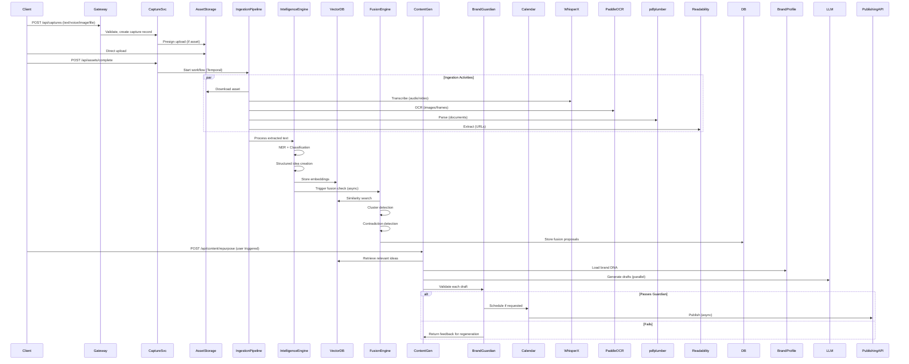

# IdeaOS System Architecture

**Version:** 1.0  
**Status:** Draft  
**Last Updated:** 2026-10-31

---

## 1. High-Level Architecture

```
┌─────────────────────────────────────────────────────────────────────────────────────┐
│                                   CLIENTS                                            │
│  ┌─────────────┐  ┌─────────────┐  ┌─────────────┐  ┌─────────────┐  ┌──────────┐  │
│  │   Desktop   │  │   Browser   │  │    iOS      │  │    Web      │  │  API     │  │
│  │  (Tauri)    │  │  Extension  │  │   App       │  │  App (Next) │  │ Clients  │  │
│  └──────┬──────┘  └──────┬──────┘  └──────┬──────┘  └──────┬──────┘  └────┬─────┘  │
└─────────┼────────────────┼────────────────┼────────────────┼────────────────┼────────┘
          │                │                │                │                │
          ▼                ▼                ▼                ▼                ▼
┌─────────────────────────────────────────────────────────────────────────────────────┐
│                              API GATEWAY (Kong / Cloudflare)                         │
│                    Rate Limiting │ Auth │ Routing │ Observability                   │
└────────────────────────────────────┬────────────────────────────────────────────────┘
                                     │
         ┌───────────────────────────┼───────────────────────────┐
         ▼                           ▼                           ▼
┌──────────────────┐      ┌──────────────────┐      ┌──────────────────┐
│  AUTH SERVICE    │      │  CAPTURE SERVICE │      │  WORKSPACE SVC   │
│  (Clerk/Auth0)   │      │  (FastAPI)       │      │  (PostgREST)     │
└──────────────────┘      └────────┬─────────┘      └──────────────────┘
                                   │
                    ┌──────────────┼──────────────┐
                    ▼              ▼              ▼
            ┌────────────┐ ┌────────────┐ ┌────────────┐
            │  INGESTION │ │  INTELLIGENCE│ │  FUSION    │
            │  PIPELINE  │ │  ENGINE      │ │  ENGINE    │
            │  (Temporal)│ │  (Workers)   │ │  (Workers) │
            └─────┬──────┘ └─────┬──────┘ └─────┬──────┘
                  │              │              │
                  ▼              ▼              ▼
         ┌────────────────────────────────────────────────┐
         │              DATA LAYER                        │
         │  ┌─────────┐ ┌─────────┐ ┌─────────┐          │
         │  │PostgreSQL│ │ pgvector│ │  Redis  │          │
         │  │ (Primary)│ │ (Vector)│ │ (Cache) │          │
         │  └─────────┘ └─────────┘ └─────────┘          │
         └────────────────────────────────────────────────┘
                  │              │              │
                  ▼              ▼              ▼
         ┌────────────┐ ┌────────────┐ ┌────────────┐
         │  CONTENT   │ │  BRAND     │ │  CALENDAR  │
         │  GENERATION│ │  GUARDIAN  │ │  & SYNC    │
         │  (Workers) │ │  (Workers) │ │  (Workers) │
         └────────────┘ └────────────┘ └────────────┘
```

### 1.1 Component Overview

| Layer | Components | Technology |
|-------|------------|------------|
| **Clients** | Desktop, Browser Ext, iOS, Web, API | Tauri, WebExtensions, Swift/SwiftUI, Next.js, OpenAPI |
| **Edge** | API Gateway, CDN, WAF | Kong/Cloudflare, Cloudflare Workers |
| **Auth** | Identity, Sessions, MFA, SSO | Clerk (primary) / Auth0 (enterprise) |
| **Core Services** | Capture, Workspace, Ingestion, Intelligence, Fusion, Content, Brand, Calendar | FastAPI (Python), Temporal (orchestration) |
| **Data** | Primary DB, Vector DB, Cache, Object Storage | PostgreSQL + pgvector, Redis Cluster, S3/GCS |
| **AI/ML** | Embeddings, LLMs, Transcription, NER, NLI | OpenAI/Anthropic APIs, WhisperX, spaCy, DeBERTa |
| **Observability** | Metrics, Logs, Traces, Alerts | Prometheus, Grafana, Loki, Tempo, PagerDuty |

---

## 2. Technology Stack Details

### 2.1 Backend Services

| Service | Language | Framework | Deployment |
|---------|----------|-----------|------------|
| **API Gateway** | TypeScript | Hono / Kong | Cloudflare Workers / K8s |
| **Capture Service** | Python | FastAPI | K8s (HPA: CPU>70%) |
| **Ingestion Pipeline** | Python | Temporal.io | K8s (dedicated workers) |
| **Intelligence Engine** | Python | FastAPI + Celery | K8s (GPU nodes for local models) |
| **Fusion Engine** | Python | FastAPI + Celery | K8s |
| **Content Generation** | Python | FastAPI + LangGraph | K8s |
| **Brand Guardian** | Python | FastAPI | K8s |
| **Calendar/Sync** | Python | FastAPI | K8s |
| **Workspace Service** | TypeScript | PostgREST / Supabase | Managed |

### 2.2 Data Layer

| Component | Technology | Configuration |
|-----------|------------|---------------|
| **Primary DB** | PostgreSQL 16 | Multi-AZ, read replicas, PgBouncer |
| **Vector Search** | pgvector 0.7+ | HNSW (m=16, ef_construction=64) |
| **Cache** | Redis 7 Cluster | 3 shards, AOF persistence |
| **Object Storage** | S3 / GCS | Versioned, lifecycle policies |
| **Queue** | Redis Streams / Temporal | Dead letter queues, retry policies |
| **Search** | PostgreSQL FTS + pgvector | Hybrid search with RRF |

### 2.3 AI/ML Stack

| Capability | Primary | Fallback | Local Option |
|------------|---------|----------|--------------|
| **LLM (Generation)** | Claude 3.5 Sonnet | GPT-4o | Llama 3.1 70B (vLLM) |
| **LLM (Reasoning)** | Claude 3.5 Opus | o1-preview | - |
| **Embeddings** | text-embedding-3-large | voyage-3 | BGE-M3 (local) |
| **Transcription** | WhisperX (API) | Deepgram | Whisper.cpp (local) |
| **NER** | spaCy (en_core_web_lg) | GLiNER | - |
| **NLI** | DeBERTa-v3-large | - | - |
| **Image Embedding** | CLIP ViT-L/14 | - | - |
| **OCR** | PaddleOCR | Tesseract | - |

### 2.4 Client Stack

| Platform | Framework | Key Libraries |
|----------|-----------|---------------|
| **Web** | Next.js 15 (App Router) | React 19, TanStack Query, Zustand, shadcn/ui |
| **Desktop** | Tauri 2 | Rust, WebView2/WebKitGTK, system-tray |
| **Browser Ext** | WXT / Plasmo | React, Background scripts, Content scripts |
| **iOS** | SwiftUI + SwiftData | WidgetKit, Shortcuts, BackgroundTasks |

---

## 3. Service Boundaries & Communication

### 3.1 Service Contracts

```
┌─────────────────┐     ┌─────────────────┐     ┌─────────────────┐
│  Capture Svc    │────▶│  Ingestion      │────▶│  Intelligence   │
│  (Ingest API)   │     │  Pipeline       │     │  Engine         │
└─────────────────┘     └─────────────────┘     └────────┬────────┘
                                                         │
                              ┌──────────────────────────┘
                              ▼
                     ┌─────────────────┐     ┌─────────────────┐
                     │  Fusion Engine  │────▶│  Content Gen    │
                     └─────────────────┘     └────────┬────────┘
                                                      │
                              ┌──────────────────────┘
                              ▼
                     ┌─────────────────┐     ┌─────────────────┐
                     │  Brand Guardian │────▶│  Calendar/Sync  │
                     └─────────────────┘     └─────────────────┘
```

### 3.2 Communication Patterns

| Pattern | Use Case | Technology |
|---------|----------|------------|
| **Sync RPC** | User-facing reads/writes | REST (OpenAPI 3.1), gRPC (internal) |
| **Async Commands** | Long-running processing | Temporal Workflows |
| **Event Streaming** | Cross-service notifications | Redis Streams / Kafka |
| **Real-time** | Collaborative editing, presence | WebSocket (Socket.io) |
| **Batch** | Analytics, fine-tuning | Airflow / Temporal batch |

### 3.3 Service APIs (Internal)

```yaml
# Capture Service
POST   /internal/captures              # Create capture
GET    /internal/captures/{id}         # Get capture with assets
POST   /internal/captures/{id}/retry   # Re-process failed

# Ingestion Pipeline (Temporal Activities)
Activity: transcribe_audio(asset_id)
Activity: extract_text_from_document(asset_id)
Activity: extract_frames_from_video(asset_id)
Activity: ocr_image(asset_id)

# Intelligence Engine
POST   /internal/ideas/extract         # Extract ideas from processed capture
POST   /internal/ideas/embed           # Generate embeddings
POST   /internal/ideas/classify        # Type classification
POST   /internal/ideas/link_entities   # Entity linking

# Fusion Engine
POST   /internal/fusion/propose        # Generate fusion proposals
POST   /internal/fusion/cluster        # Detect clusters
POST   /internal/fusion/detect_contradictions

# Content Generation
POST   /internal/content/generate      # Generate draft from idea + template
POST   /internal/content/repurpose     # Multi-format generation

# Brand Guardian
POST   /internal/brand/validate        # Full validation pipeline
POST   /internal/brand/score_style     # Style similarity scoring
```

---

## 4. Data Flow: Capture → Ingestion → Intelligence → Fusion → Generation

### 4.1 Capture Flow (Happy Path)



### 4.2 Detailed Processing Steps

#### Step 1: Capture Creation
```
Input: { type: "voice"|"text"|"image"|"file"|"url", content, metadata }
Processing:
  1. Validate workspace access (RLS)
  2. Create capture record (status: pending)
  3. If asset: return presigned URL
  4. If inline: store directly
Output: { capture_id, asset_id?, presigned_url? }
```

#### Step 2: Asset Ingestion (Temporal Workflow)
```python
# Workflow: AssetIngestionWorkflow
class AssetIngestionWorkflow:
    def __init__(self, asset_id: UUID):
        self.asset_id = asset_id
    
    async def run(self):
        asset = await self.get_asset()
        
        # Parallel activities
        results = await asyncio.gather(
            self.transcribe_if_audio(asset),
            self.ocr_if_image(asset),
            self.parse_if_document(asset),
            self.extract_if_url(asset),
            return_exceptions=True
        )
        
        # Merge results
        extracted_text = self.merge_results(results)
        
        # Store extracted text on asset
        await self.update_asset(asset_id, extracted_text=extracted_text)
        
        # Trigger intelligence
        await self.signal_intelligence_engine(capture_id=asset.capture_id)
```

#### Step 3: Intelligence Processing
```python
# Pipeline: IdeaExtractionPipeline
class IdeaExtractionPipeline:
    async def process(self, capture_id: UUID, text: str):
        # 1. Segment into semantic units
        segments = await self.segment_text(text)
        
        # 2. Parallel extraction per segment
        ideas = await asyncio.gather(*[
            self.extract_idea(segment) for segment in segments
        ])
        
        # 3. Deduplicate via embedding similarity
        ideas = await self.deduplicate(ideas)
        
        # 4. Enrich each idea
        for idea in ideas:
            idea.embedding = await self.embed(idea.content)
            idea.entities = await self.extract_entities(idea.content)
            idea.type = await self.classify_type(idea.content)
            idea.claims = await self.extract_claims(idea.content)
        
        # 5. Bulk insert with vector index update
        await self.bulk_insert_ideas(ideas)
        
        return ideas
```

#### Step 4: Fusion Engine (Background)
```python
# Scheduled: Every 5 minutes per workspace
class FusionEngine:
    async def run_fusion_cycle(self, workspace_id: UUID):
        # 1. Get new/updated ideas since last run
        new_ideas = await self.get_recent_ideas(workspace_id, since=last_run)
        
        # 2. For each new idea, find connections
        for idea in new_ideas:
            # Semantic neighbors
            neighbors = await self.vector_search(idea.embedding, k=50)
            
            # Temporal neighbors (captured within 1hr)
            temporal = await self.get_temporal_neighbors(idea, window_hours=1)
            
            # Explicit relations
            explicit = await self.get_explicit_relations(idea)
            
            # Score and rank connections
            connections = self.score_connections(idea, neighbors, temporal, explicit)
            
            # Generate fusion proposals for high-scoring groups
            proposals = await self.generate_proposals(idea, connections)
            await self.store_proposals(proposals)
        
        # 3. Cluster detection (weekly full, daily incremental)
        if self.should_cluster():
            clusters = await self.detect_clusters(workspace_id)
            await self.store_clusters(clusters)
        
        # 4. Contradiction detection
        contradictions = await self.detect_contradictions(workspace_id)
        await self.store_contradictions(contradictions)
```

#### Step 5: Content Generation + Brand Guardian
```python
# ContentGenerationWorkflow (Temporal)
class ContentGenerationWorkflow:
    async def run(self, idea_ids: List[UUID], templates: List[str], brand_id: UUID):
        # 1. Load context
        ideas = await self.load_ideas(idea_ids)
        brand = await self.load_brand_profile(brand_id)
        context = self.build_context(ideas, brand)
        
        # 2. Parallel generation per template
        drafts = await asyncio.gather(*[
            self.generate_draft(template, context) for template in templates
        ])
        
        # 3. Brand Guardian validation (sequential per draft)
        validated = []
        for draft in drafts:
            result = await self.brand_guardian.validate(draft, brand)
            if result.passed:
                validated.append(draft)
            else:
                # Auto-retry with feedback (max 2 retries)
                retry = await self.regenerate_with_feedback(draft, result.feedback, brand)
                retry_result = await self.brand_guardian.validate(retry, brand)
                if retry_result.passed:
                    validated.append(retry)
                else:
                    validated.append({"draft": retry, "issues": retry_result.issues, "needs_review": True})
        
        return validated
```

---

## 5. Security Architecture

### 5.1 Authentication & Authorization

```
┌─────────────────────────────────────────────────────────────────┐
│                        AUTH FLOW                                 │
├─────────────────────────────────────────────────────────────────┤
│                                                                  │
│  Client ──▶ Clerk/Auth0 ──▶ JWT (access + refresh)              │
│                    │                                             │
│                    ▼                                             │
│            ┌─────────────┐                                       │
│            │ Token Claims│                                       │
│            │ sub, ws_id, │                                       │
│            │ roles, perm │                                       │
│            └─────────────┘                                       │
│                    │                                             │
│                    ▼                                             │
│  API Gateway: Validates JWT, extracts claims, adds headers      │
│                    │                                             │
│                    ▼                                             │
│  Services: Read X-Workspace-ID, X-User-Roles from headers       │
│                    │                                             │
│                    ▼                                             │
│  Database: Row Level Security enforces workspace isolation      │
│                                                                  │
└─────────────────────────────────────────────────────────────────┘
```

### 5.2 Row Level Security (RLS) Policies

```sql
-- Example: Ideas table RLS
ALTER TABLE ideas ENABLE ROW LEVEL SECURITY;

-- Users can only see ideas in their workspaces
CREATE POLICY ideas_workspace_isolation ON ideas
  USING (workspace_id IN (
    SELECT workspace_id FROM workspace_members 
    WHERE user_id = current_setting('app.current_user_id')::uuid
  ));

-- Contributors can only insert, not update/delete
CREATE POLICY ideas_contributor_insert ON ideas
  FOR INSERT WITH CHECK (
    current_setting('app.current_user_role') IN ('owner','admin','editor','contributor')
  );

CREATE POLICY ideas_editor_update ON ideas
  FOR UPDATE USING (
    current_setting('app.current_user_role') IN ('owner','admin','editor')
  );
```

### 5.3 Data Protection

| Layer | Protection |
|-------|------------|
| **Transport** | TLS 1.3 everywhere; mTLS for service-to-service |
| **At Rest** | AES-256 (DB, S3, Redis); customer-managed keys (Enterprise) |
| **In Use** | Enclaves for key operations; field-level encryption for PII |
| **Secrets** | HashiCorp Vault / AWS Secrets Manager; rotation every 90 days |
| **Audit** | Immutable audit log (append-only table + S3 archive) |

### 5.4 Network Security

```
┌────────────────────────────────────────────────────────────┐
│                    NETWORK ZONES                            │
├────────────────────────────────────────────────────────────┤
│                                                             │
│  PUBLIC ZONE                                                │
│  ├── Cloudflare (WAF, DDoS, Bot Management)                │
│  └── API Gateway (Rate limit, Auth validation)             │
│                                                             │
│  ────────────────────────────────────────────────────────  │
│                                                             │
│  APPLICATION ZONE (Private Subnets)                        │
│  ├── Auth Service                                           │
│  ├── Capture Service                                        │
│  ├── Ingestion Workers                                      │
│  ├── Intelligence Workers                                   │
│  ├── Fusion Workers                                         │
│  ├── Content Workers                                        │
│  ├── Brand Workers                                          │
│  └── Calendar Workers                                       │
│                                                             │
│  ────────────────────────────────────────────────────────  │
│                                                             │
│  DATA ZONE (Private Subnets, No Internet)                  │
│  ├── PostgreSQL Primary (Multi-AZ)                         │
│  ├── PostgreSQL Read Replicas                              │
│  ├── Redis Cluster                                         │
│  └── Temporal Server                                       │
│                                                             │
│  ────────────────────────────────────────────────────────  │
│                                                             │
│  AI ZONE (GPU Subnets, Egress-controlled)                  │
│  ├── vLLM (Local LLMs)                                     │
│  ├── WhisperX Workers                                      │
│  └── Embedding Workers                                     │
│                                                             │
└────────────────────────────────────────────────────────────┘
```

---

## 6. Deployment Architecture

### 6.1 Infrastructure (Terraform)

```hcl
# Multi-region deployment
module "primary_region" {
  source = "./modules/aws-region"
  region = "us-east-1"
  environment = "production"
}

module "secondary_region" {
  source = "./modules/aws-region"
  region = "eu-west-1"
  environment = "production"
  is_failover = true
}

# Per-region resources:
# - EKS Cluster (managed node groups + Karpenter)
# - RDS PostgreSQL (Multi-AZ, read replicas)
# - ElastiCache Redis Cluster
# - S3 Bucket (versioned, replicated)
# - CloudFront Distribution
# - Route53 Health Checks + Failover Records
```

### 6.2 Kubernetes Deployment

```yaml
# Example: Capture Service Deployment
apiVersion: apps/v1
kind: Deployment
metadata:
  name: capture-service
  namespace: ideaos-prod
spec:
  replicas: 3
  selector:
    matchLabels:
      app: capture-service
  template:
    spec:
      containers:
      - name: capture-service
        image: ideaos/capture-service:v1.2.3
        resources:
          requests:
            memory: "512Mi"
            cpu: "250m"
          limits:
            memory: "1Gi"
            cpu: "1000m"
        env:
        - name: DATABASE_URL
          valueFrom:
            secretKeyRef:
              name: db-credentials
              key: url
        - name: TEMPORAL_ADDRESS
          value: "temporal:7233"
        livenessProbe:
          httpGet:
            path: /health
            port: 8000
          initialDelaySeconds: 10
        readinessProbe:
          httpGet:
            path: /ready
            port: 8000
          initialDelaySeconds: 5
---
apiVersion: autoscaling/v2
kind: HorizontalPodAutoscaler
metadata:
  name: capture-service-hpa
spec:
  scaleTargetRef:
    apiVersion: apps/v1
    kind: Deployment
    name: capture-service
  minReplicas: 3
  maxReplicas: 50
  metrics:
  - type: Resource
    resource:
      name: cpu
      target:
        type: Utilization
        averageUtilization: 70
  - type: Pods
    pods:
      metric:
        name: http_requests_per_second
      target:
        type: AverageValue
        averageValue: "1000"
```

### 6.3 CI/CD Pipeline

```yaml
# .github/workflows/deploy.yml
name: Deploy to Production

on:
  push:
    tags: ['v*']

jobs:
  test:
    runs-on: ubuntu-latest
    steps:
      - uses: actions/checkout@v4
      - name: Run tests
        run: make test-all
      - name: Security scan
        run: make security-scan
  
  build:
    needs: test
    runs-on: ubuntu-latest
    steps:
      - name: Build & push images
        run: make docker-build-push
  
  deploy-staging:
    needs: build
    runs-on: ubuntu-latest
    environment: staging
    steps:
      - name: Deploy to staging
        run: make deploy-staging
      - name: Run integration tests
        run: make integration-test
  
  deploy-production:
    needs: deploy-staging
    runs-on: ubuntu-latest
    environment: production
    steps:
      - name: Blue-green deploy
        run: make deploy-blue-green
      - name: Smoke tests
        run: make smoke-test
      - name: Promote
        run: make promote-blue-green
```

### 6.4 Observability Stack

| Component | Tool | Purpose |
|-----------|------|---------|
| **Metrics** | Prometheus + Grafana | Service SLIs, business metrics, capacity |
| **Logs** | Loki + Grafana | Structured logging, query by trace_id |
| **Traces** | Tempo + Grafana | Distributed tracing (W3C TraceContext) |
| **Alerts** | Alertmanager + PagerDuty | SLO-based alerts, on-call rotation |
| **Profiling** | Pyroscope | Continuous profiling for CPU/memory |
| **RUM** | Cloudflare Web Analytics | Real user monitoring for web app |

### 6.5 Disaster Recovery

| Scenario | RTO | RPO | Strategy |
|----------|-----|-----|----------|
| **Single AZ failure** | <30s | 0 | Multi-AZ RDS, multi-AZ EKS |
| **Region failure** | <5min | <1min | Cross-region read replica promotion; Route53 failover |
| **Data corruption** | <1hr | <5min | Point-in-time recovery (PITR); WAL archiving |
| **Ransomware** | <4hr | <1hr | Immutable backups (S3 Object Lock); air-gapped copy |

---

## 7. Scalability Targets

| Metric | Target | Scaling Strategy |
|--------|--------|------------------|
| **Concurrent Users** | 100K | Stateless services + HPA |
| **Captures/day** | 1M | Partitioned ingestion queues |
| **Ideas stored** | 100M | pgvector partitioning by workspace |
| **Vector searches/sec** | 10K | Read replicas + HNSW tuning |
| **Content generations/min** | 5K | Async queue + GPU worker pool |
| **WebSocket connections** | 50K | Socket.io cluster + Redis adapter |

---

## 8. Cost Optimization

| Component | Strategy | Estimated Savings |
|-----------|----------|-------------------|
| **LLM Inference** | Route simple tasks to Haiku/3.5 Sonnet; cache embeddings | 60% |
| **Vector Search** | pgvector on existing PG; no separate Pinecone/Weaviate | 80% |
| **Compute** | Spot instances for batch workers; Karpenter rightsizing | 40% |
| **Storage** | S3 Intelligent Tiering; lifecycle to Glacier | 30% |
| **Bandwidth** | Cloudflare CDN + Workers for edge processing | 50% |

---

## 9. Appendix: Architecture Decision Records (ADRs)

| ADR | Title | Status |
|-----|-------|--------|
| ADR-001 | Use Temporal for durable execution | Accepted |
| ADR-002 | PostgreSQL + pgvector over dedicated vector DB | Accepted |
| ADR-003 | Clerk for auth (not custom) | Accepted |
| ADR-004 | Tauri over Electron for desktop | Accepted |
| ADR-005 | Hybrid search (vector + FTS) over pure vector | Accepted |
| ADR-006 | Brand Guardian as separate service | Accepted |
| ADR-007 | Multi-region active-passive for DR | Accepted |

---